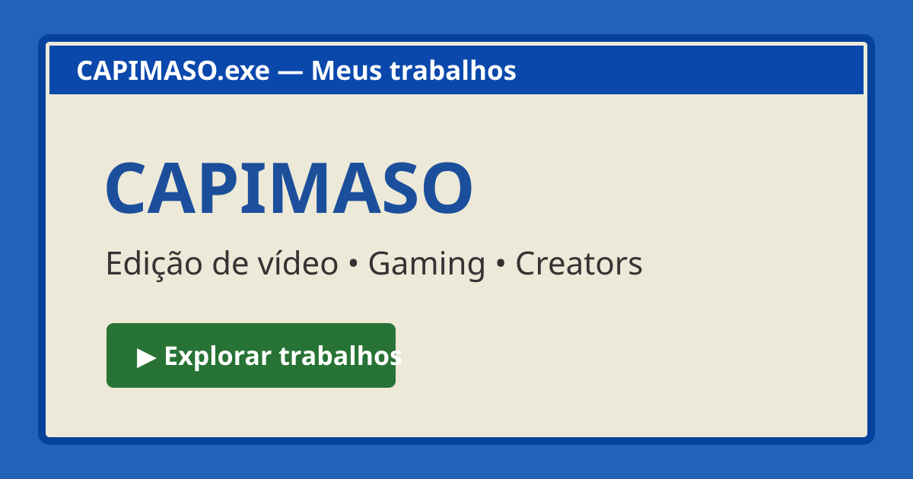

<div align="center">



# 🖥️ CAPIMASO.exe

**Portfólio de editor de vídeo · Windows XP Edition**

`[ Meu computador ]` · `[ Meus trabalhos ]` · `[ Windows Media Player ]` · `[ Outlook Express ]`

**Uma área de trabalho para explorar. Não uma landing page fingindo ser um sistema operacional.**

</div>

---

## 🟦 Bem-vindo ao Windows XP do CAPIMASO

A identidade foi reconstruída tendo o **Windows XP com tema Luna** como referência: barra azul, botão Iniciar verde, janelas com controles clássicos, Explorador de Arquivos, menu de duas colunas e programas familiares. O conteúdo do CAPIMASO continua sendo a parte mais importante: vídeos, thumbnails, habilidades, valores, comentários e contato.

Acesse o portfólio pela área de trabalho, pelo menu **iniciar** ou pelos botões da janela principal.

> **Projeto Next.js + React + TypeScript.** Sem serviço de banco de dados para o portfólio e sem API key obrigatória.

## ▶ Instalar e rodar

Requisitos: **Node.js 20.9+**, npm e conexão com a internet na primeira instalação para dependências e recuperação de imagens originais.

```bash
npm install
npm run dev
```

Abra `http://localhost:3000`.

- Portfólio público: `http://localhost:3000`
- Estúdio de upload: **`http://localhost:3000/studio`**

`npm run dev` tenta recuperar automaticamente os arquivos da pasta `public` do repositório original **somente se não estiverem presentes**. Se quiser repetir manualmente:

```bash
npm run assets:sync
```

### 🚀 Publicar usando seu GitHub atual

1. Descompacte o ZIP.
2. **Copie o conteúdo da pasta descompactada para a raiz do repositório `capimaso-portfolio`**, substituindo os arquivos de mesmo nome. Não apague manualmente `public/images`, `public/videos` ou pastas antigas: seus arquivos continuam válidos.
3. Rode `npm install` e `npm run dev` para conferir.
4. Execute `npm run build`. Depois publique os arquivos via commit/push ou upload pelo GitHub; a Vercel poderá fazer o deploy.
5. Na Vercel, o framework é Next.js e o build padrão é `npm run build`.

**Nota sobre o pacote:** este ZIP contém todo o código novo, suas configurações, o fundo XP inspirado, os dados do portfólio, a documentação e os scripts de recuperação. **Fotos e thumbnails binários já existentes não foram baixados diretamente neste ambiente.** O script `scripts/sync-original-assets.mjs` os recupera do seu repositório público na primeira execução, sem sobrescrever arquivos existentes. Ao aplicar sobre o repositório atual, eles já estarão presentes. Isso exige que a branch `main` original continue disponível durante a migração ou que você mantenha a pasta `public` existente. O script recupera arquivos de um **commit original fixado** (não depende do conteúdo da `main` após a atualização). Nenhuma foto original foi substituída por uma foto inventada.

## ✨ Atualização 2.1 — idioma, wallpaper, player, cursores e menu Iniciar

Todos os recursos novos funcionam **em cima da edição XP**, sem trocar de framework nem perder o conteúdo anterior.

### 🌐 Inglês e português

- **EN** e **PT** aparecem sempre na barra de tarefas, ao lado do relógio. O site **abre em inglês na primeira visita**.
- Ao trocar, são traduzidos área de trabalho, menu Iniciar, programas, textos principais, projetos originais, contato e Estúdio. A escolha é preservada no navegador.
- As traduções moram em `lib/locale-dictionary.ts`. Para adicionar conteúdo novo traduzido, use `t('Texto em português')` com o hook `useT` nos componentes React, e inclua a frase no dicionário.
- Conteúdo que você adicionar futuramente (novos títulos, comentários, serviços) não será traduzido automaticamente: adicione suas traduções manualmente ao dicionário para evitar alterar nomes próprios.

### 🏞️ Papéis de parede: Bliss padrão + duas alternativas

Coloque a sua cópia da fotografia **Bliss do Windows XP** em `public/images/xp-bliss.jpg`. Essa imagem **não está no ZIP** por questões de direitos autorais. O site já abre por padrão com `/images/xp-bliss.jpg` para visitantes novos, desde que o arquivo esteja presente.

Clique com o botão direito na área de trabalho e abra **Display Properties / Propriedades de exibição**. Você verá quatro opções:

1. **Windows XP Bliss (default)** — seu `public/images/xp-bliss.jpg`, já selecionado por padrão.
2. **XP Hills (illustration)** — o fundo ilustrado que eu criei (`public/images/xp-hills.svg`).
3. **Original Repo Wallpaper** — o wallpaper do repositório anterior (`public/images/wallpaper.svg`), recuperado pelo script de sincronização de assets.
4. **Uploaded Image** — uma imagem selecionada por **Browse image…**, guardada localmente no navegador.

A opção "Site Image File" e seu campo de caminho foram retirados. **Restore Default** agora volta ao Bliss. Se o navegador já salvou uma preferência antiga, clique em Restore Default uma vez; visitantes novos usam Bliss automaticamente. Para publicação, inclua sua imagem Bliss no GitHub junto com o código.

### ▶ Windows Media Player

- Vídeos longos do YouTube são encaixados no espaço disponível em **16:9**; curtos do Google Drive ficam em **9:16**. Os iframes não ultrapassam os limites da janela.
- Ao abrir um vídeo incorporado do YouTube ou um MP4/WebM local, o site tenta iniciá-lo automaticamente **sem som**, como exigem as políticas de autoplay dos navegadores. Use o player para ligar o áudio. A reprodução pode depender de permissões e restrições do próprio YouTube.
- Reels antigos que **ainda são somente links do Instagram** continuam abrindo externamente; para assistir dentro do player, adicione o link do arquivo no Google Drive.

### 🖱️ Cursores e ícones do menu

- Usamos os quatro cursores da pasta `public/icons`: `cursor.svg`, `cursor-pointer.svg`, `cursor-text.svg` e `cursor-drag.svg`. Eles foram criados no seu projeto original e **não são substituídos** por este ZIP. Caso estejam faltando, rode `npm run assets:sync` com acesso à internet. O navegador tem cursores padrão como fallback.
- Os botões inferiores do menu Iniciar agora usam **ícones SVG desenhados na interface**, em vez de emoji ou glifo dependente da fonte do sistema.

### 📦 Instalar a atualização por cima da anterior

1. **Faça commit ou backup** do portfólio que já está funcionando.
2. Extraia o ZIP e copie **os arquivos que estão dentro dele** para a raiz de `capimaso-portfolio`, confirmando substituir arquivos com o mesmo nome.
3. **Não apague** pastas antigas de `public/images`, `public/videos` e nem o seu `data/showcase.json` se já adicionou vídeos pelo Estúdio. Nesse caso **mantenha seu `data/showcase.json` mais recente**, pois o ZIP contém apenas a lista original de exemplo.
4. Com o Node.js e as dependências instaladas, rode `npm run check`, `npm run dev` e `npm run build` para verificar a atualização. Não é preciso apagar `node_modules` se a sua instalação já funciona.

> Observação: o ZIP traz os dados do showcase anterior porque é um projeto completo; se você já editou esses dados, preserve suas mudanças ao copiar.

---

## 🎬 Reels e Shorts com Google Drive

Os vídeos curtos usam o player incorporado do Google Drive em **9:16**. Os arquivos de vídeo ficam no Drive; apenas as capas continuam no repositório. O player inicia pelo botão de reprodução, sem autoplay forçado.

### Adicionar pelo Estúdio

1. Envie o vídeo ao Google Drive e compartilhe como **Qualquer pessoa com o link → Leitor**.
2. Rode `npm run dev` e abra **http://localhost:3000/studio**.
3. Preencha título, descrição e categoria; cole o link do Drive e escolha a capa JPG/PNG/WebP.
4. Confira a prévia e clique em **Adicionar ao showcase**.
5. Faça commit/push de `data/showcase.json` e da nova imagem em `public/images/thumbs/`.

O Estúdio continua disponível apenas em desenvolvimento. Ele salva **o link e a capa**, sem baixar ou gravar o vídeo. A capa deve ser escolhida manualmente; o player do Drive não permite capturar frames diretamente pelo site.

### Configurar os vídeos existentes ou adicionar manualmente

Em **`data/showcase.json`**, preencha o campo `video` de cada curto com seu link real:

```json
{
  "id": "meu-short",
  "title": "Meu novo Short",
  "description": "O que editei e para quem",
  "category": "Gaming • Short form",
  "format": "short",
  "video": "https://drive.google.com/file/d/SEU_ID_REAL/view?usp=sharing",
  "thumbnail": "/images/thumbs/meu-short.jpg",
  "software": "Premiere Pro"
}
```

Links `/file/d/ID/view`, `/file/d/ID/preview`, `/open?id=ID` e `/uc?id=ID` são aceitos. Links com `resourcekey` preservam essa chave. Use o link de **um arquivo**, não de uma pasta. O botão **Abrir no Google Drive** permite abrir o vídeo fora do player.

Scarface e Stefany já usam os links reais fornecidos pelo proprietário, mantendo seus dados e capas. Os MP4 locais foram removidos; `public/videos/` está no `.gitignore` e a sincronização não baixa mais vídeos.

### 📼 E os vídeos longos?

Use **somente links do YouTube**, como solicitado. O player aceita `youtube.com/watch?v=...` e `youtu.be/...`:

```json
{
  "id": "meu-video-longo",
  "title": "Vídeo para YouTube",
  "description": "Um trabalho de edição horizontal",
  "category": "Gaming • Vídeo longo",
  "format": "long",
  "video": "https://www.youtube.com/watch?v=SEU_ID",
  "thumbnail": "",
  "software": "Premiere Pro"
}
```

A thumbnail é extraída do YouTube quando `thumbnail` está vazia. Links antigos de Instagram continuam registrados, mas dependem de acesso externo: **para assistir diretamente no site, configure o link do arquivo no Google Drive.** O site não baixa vídeos do Instagram.

## 📁 Onde editar cada coisa

| Quero mudar... | Arquivo correto |
| --- | --- |
| Nome, bio, profissão, frase principal e SEO | [`data/profile.ts`](data/profile.ts) |
| Trabalhos, vídeos e thumbnails | [`data/showcase.json`](data/showcase.json) |
| Redes e email | [`data/socials.ts`](data/socials.ts) |
| Softwares que utilizo | [`data/skills.ts`](data/skills.ts) |
| Serviços e valores | [`data/services.ts`](data/services.ts) |
| Recados reais de clientes | [`data/comments.ts`](data/comments.ts) |
| Vídeo do botão azul “Vídeo de apresentação” | [`data/media.ts`](data/media.ts) |
| Cores, formas, responsividade e XP Luna | [`app/xp.css`](app/xp.css) |
| Ícones e interação das janelas/menu | [`components/XpDesktop.tsx`](components/XpDesktop.tsx) |
| Conteúdo interno de cada programa | [`components/XPApps.tsx`](components/XPApps.tsx) |
| Ícones vetoriais locais | [`components/XPIcon.tsx`](components/XPIcon.tsx) |
| Cadastro local de link Drive e capa | [`app/api/studio/upload/route.ts`](app/api/studio/upload/route.ts) |
| Sincronizar mídias originais | [`scripts/sync-original-assets.mjs`](scripts/sync-original-assets.mjs) |

## 🖼️ Acervo preservado

A sincronização mantém os caminhos originais de `profile.jpg`, `scarfaceThumb.png`, `thumbs/ThumbBizu.png`, `avatars/megluuh.jpg`, SVGs de projetos e cursores. Vídeos não são mais sincronizados. A galeria **Thumbnails** lista automaticamente todas as imagens de `public/images/thumbs/` — inclusive as enviadas pelo Estúdio.

### Papel de parede XP

O fundo padrão `public/images/xp-hills.svg` é **uma arte original inspirada no clássico Bliss**. O botão direito no desktop permite alternar para `public/images/wallpaper.svg` do repositório anterior. O retrato fotográfico original do Windows XP **não é redistribuído** por razões de direitos de uso. Se você possuir um arquivo autorizado, pode substituir `xp-hills.svg` e ajustar o CSS para `.jpg` ou `.webp`.

## 🗂️ Estrutura

```text
capimaso-portfolio/
├── app/
│   ├── page.tsx                 Área de trabalho
│   ├── layout.tsx               SEO e estilos
│   ├── xp.css                   Tema Luna, layout responsivo
│   ├── studio/page.tsx          Estúdio privado local
│   └── api/studio/upload/route.ts
├── components/
│   ├── XpDesktop.tsx            Menu Iniciar, janelas, taskbar
│   ├── XPApps.tsx               Explorador, Player, serviços etc.
│   ├── XPIcon.tsx               Ícones do sistema
│   └── XPImage.tsx              Assets locais + fallback dos originais
├── data/                        Informações editáveis
├── lib/                         Leitura de mídia / helpers
├── public/
│   ├── images/                  Wallpapers, capas, avatar, thumbs/
│   └── icons/                   Cursores originais
├── scripts/sync-original-assets.mjs
├── docs/CODEX-GUIDE.md
├── MUDANCAS.md
├── docs/ANALISE-DO-ORIGINAL.md
├── AGENTS.md                    Instruções autônomas para Codex
└── package.json
```

## 🎨 Diretrizes visuais

- **Windows XP Luna Blue**, Tahoma 11–12 px, fundos creme `#ECE9D8`, sombras discretas; sem glassmorphism, blur exagerado ou card de SaaS.
- Barra de tarefas azul, botão Iniciar verde, cantos arredondados **somente no topo da janela**; menu Iniciar em duas colunas, Explorador com painel de tarefas à esquerda.
- Respeitar a distinção de formatos: **9:16 para vídeos curtos** e **16:9 para vídeos longos**.
- Priorizar legibilidade, navegação por teclado, botões reais e comportamento consistente em telas pequenas.

## ✅ Checklist de publicação

- [ ] Rodei `npm install` e `npm run dev`.
- [ ] As imagens antigas aparecem (ou executei `npm run assets:sync`).
- [ ] Abri trabalhos, recados, serviços e contatos.
- [ ] Testei um curto do **Google Drive** no Windows Media Player.
- [ ] Verifiquei a capa do Short em formato vertical.
- [ ] Conferi as URLs de YouTube dos vídeos longos.
- [ ] Rodei `npm run build`.
- [ ] Dei commit e push nas mídias + `data/showcase.json`.

---

<div align="center">

**CAPIMASO • Meu computador, meus cortes, meu jeito.**

`[ iniciar ]` `📁` `🎞️` `💾` — Interface inspirada no Windows XP, não afiliada à Microsoft.

</div>

### Atualizações sobre projetos existentes

Na versão 2.1.1 o arquivo de traduções é `lib/locale-dictionary.ts`. Se você havia copiado versões anteriores por cima, pode ter sobrado `lib/i18n.tsx` antigo; esse arquivo não é mais usado pelo desktop atual. Após copiar os arquivos novos, execute `npm run check` e `npm run build`.
